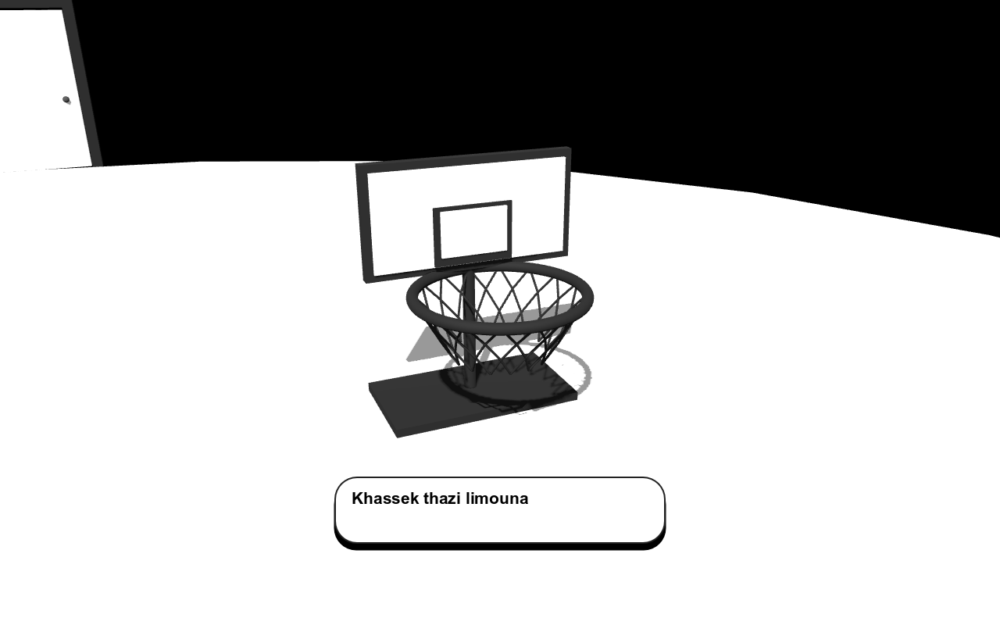
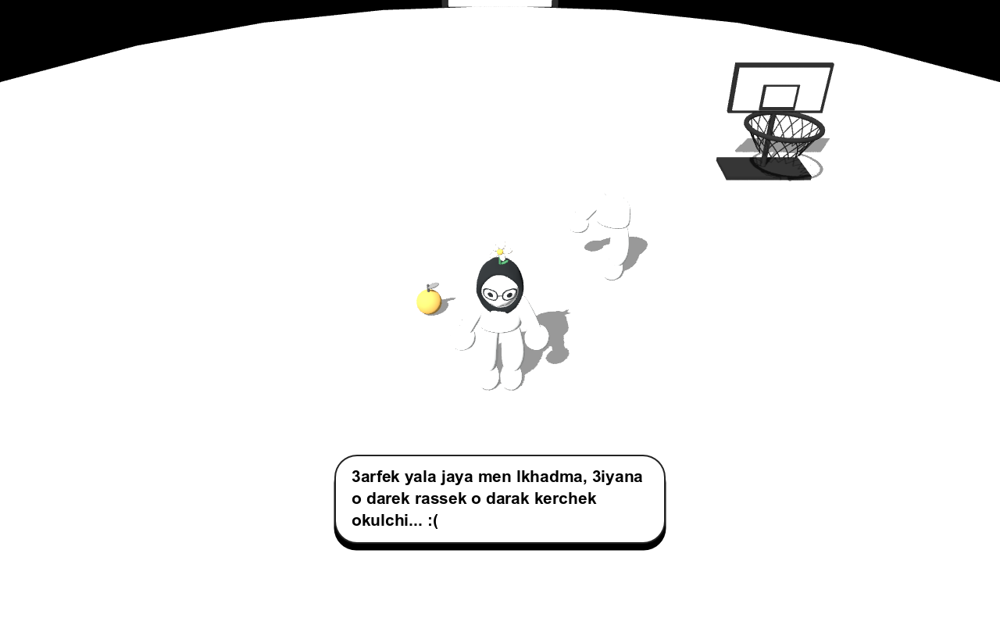
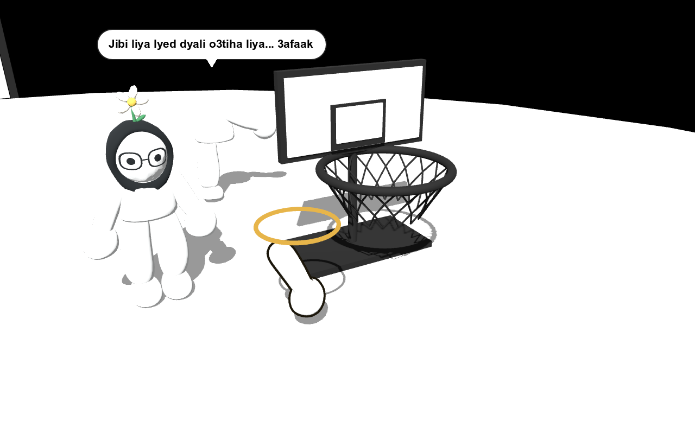

# Basket tutorial and dialogue visibility

The first puzzle uses a raised basket on the right side of the starting map. A backboard, open net and dark rim replace the floor circle. Only a descending fruit crossing the rim opening scores. Upward crossings and wide misses do not. Fruit collides with the world but cannot be deflected by either character.

The opening tiredness line and basket instruction use the user's revised wording. The gap line now correctly says `Hahiya rjli fjiha lakhra.`

During the first basket instruction, the camera eases toward the basket, holds through the spoken line, then returns to its saved view. Movement, aiming and new interactions wait during this cue. Pausing also pauses the cue. Repeated reminders do not replay it.

Speech panels have a dark outline on the white map. An offscreen or behind-camera speaker gets a bottom panel with no misleading tail. Onscreen bubbles stay within the viewport. The panel and shadow share one measured rectangle, and the full text determines its size before the reveal begins. The fallback leaves room for interaction hints.

The arm emerges beside the basket with a dark contour and gold beacon. Nearby hints show pickup, throw and arm handover controls.

Passed the actual physics throw self-test, first-stage scenario, miss counting, full journey, reunion/cake/restart, dialogue pacing, and the native basket-experience test. Native screenshots were inspected for the tutorial view, long offscreen dialogue and arm visibility. The basket test checks downward scoring, rejected upward/wide crossings, camera return, offscreen speech bounds and arm highlight state.
