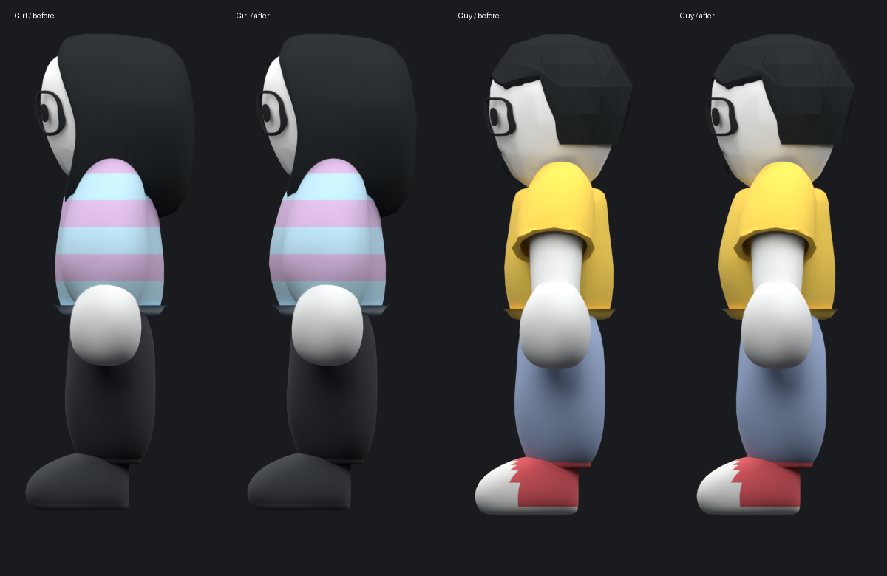
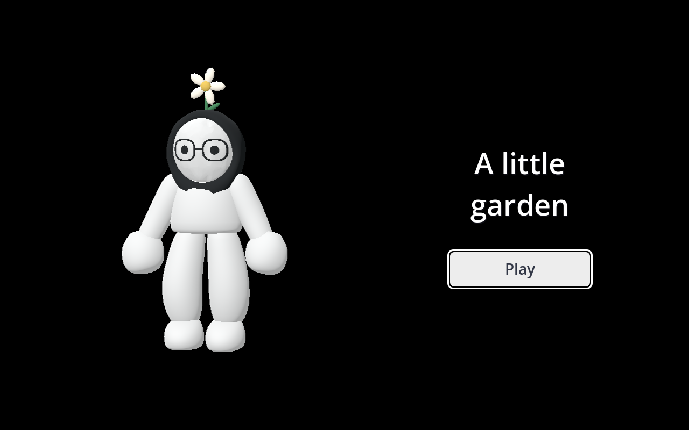
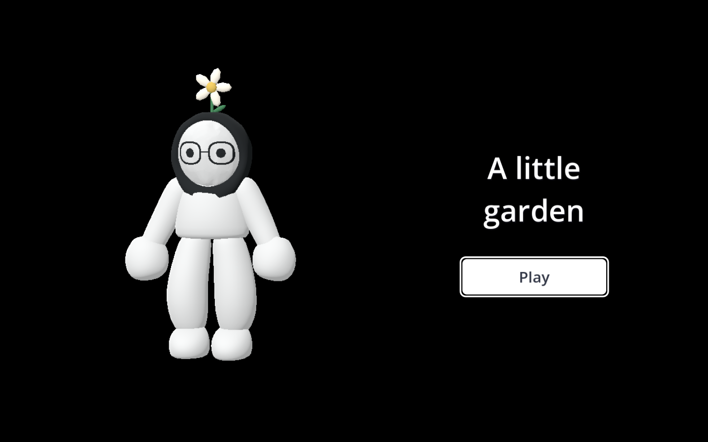

# Belly curve and entrance review

Both characters gain a small forward belly curve, visible from the side. The waist width, back, face, limb proportions, topology and rest rig remain unchanged. The separate shirt meshes follow the curve.

The entrance now shows the floating player on the left and Play on the right against black. It uses the actual character in an isolated 3D viewport, with a gentle vertical drift and relaxed bent knees. Hiding the menu stops both its animation and viewport rendering.

Normal, hover, pressed and combined hover/pressed states all have explicit light backgrounds and dark text. Keyboard focus has a visible outline. The same button factory styles the pause menu.

Inspected native renders at 960x600, 1280x800 and 1600x900. The title test checks floating movement, pointer hover, text and surface colors, initial keyboard focus, Play entering gameplay, and hidden-preview shutdown. Blender module/identity/rig checks, native garment poses, dialogue integration and the gameplay self-test pass.
