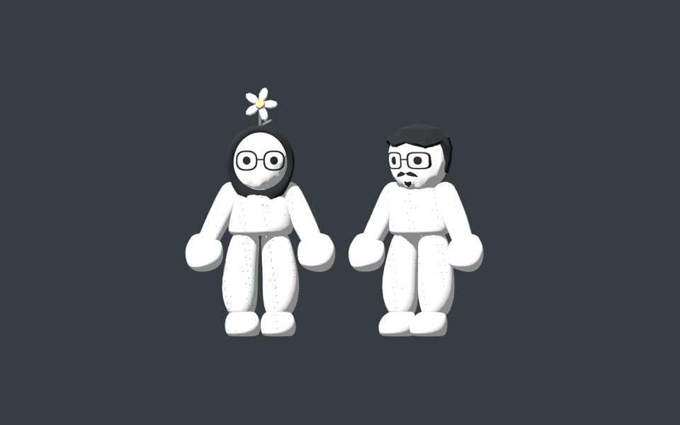
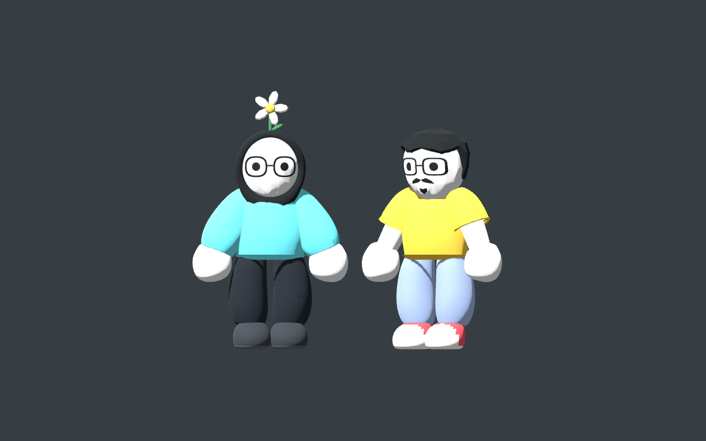

# Cyan outfit and lemon pickup

Picking up the lemon used to replay the basket instruction and reset its typewriter progress. Pickup now preserves the active message and queue. The focused regression failed before the fix and passes afterward.

Salma's sweater, sleeves, cuffs and hem use solid cyan with no stripe texture. The garment meshes and character proportions are unchanged.

Both birthday outfits appear over 0.9 seconds with a sine-eased dissolve. Complementary opaque shader masks replace the covered body without alpha sorting. Original materials return after the effect; covered modules then hide. The transition pauses with the game.

Inspected native Compatibility-renderer frames throughout the transition and the completed outfit. The dissolve uses visible fine grain during the brief change. Face, hands and identity accessories remain visible.

Validation passed: `tests/lemon_outfit.gd`, `tests/reunion_cake.gd`, `tests/soft_visuals.gd`, and the game `--self-test`. The story test includes birthday progression and chapter restart.
