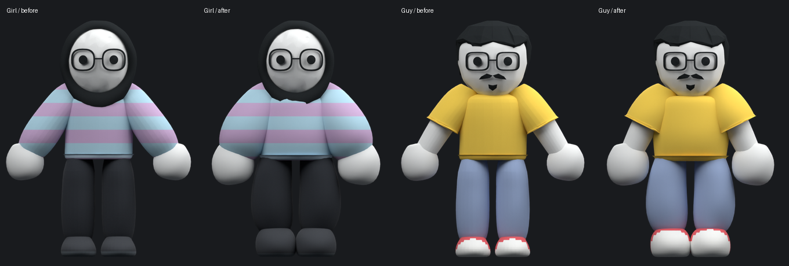
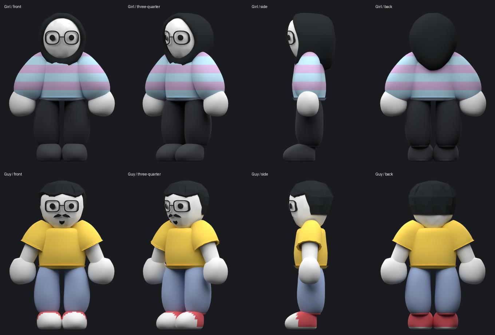
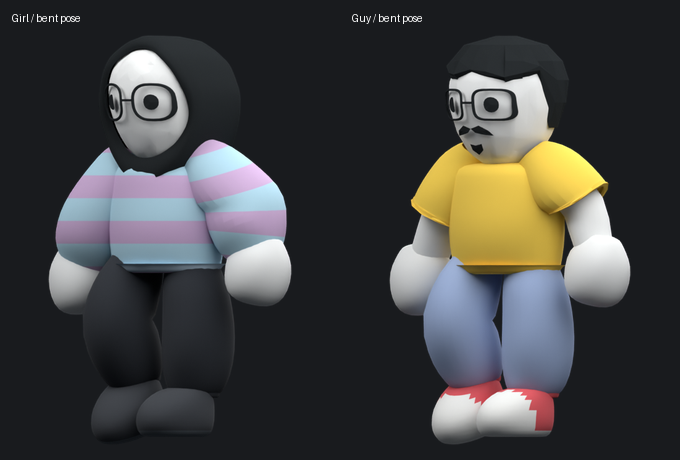

# Character design-sheet refinement

The supplied girl and guy design sheets guide this static shape pass. The previous outfits had narrow straight legs, small low shoes and regular hands. The revision adds fuller shoulders and sleeves, rounded mitten palms with a thumb-side bulge, bowed trousers and taller shoes with distinct toes and heels. The sleeve and hand centers sit closer to the torso to match the relaxed reference pose.

The faces, hood, hair, glasses and facial accessories are unchanged. Both bodies retain ten independent mesh objects, the same body vertex and face counts, and the same 15-bone rest rig. The gameplay animation controller is unchanged.

These are our Blender renders using matching orthographic cameras and equal displayed character heights. Source study images remain local. The reconstruction is closer to the reference silhouettes, but is not an exact copy of the source models.

Validation passed for unchanged identity, rig and body topology, independent modules, normalized imported skin weights, native Godot garment binding and pose renders, the gameplay self-test, and the reunion/cake sequence. Static bent poses check clothing coverage; they do not establish that the existing walk has been redesigned or perfected.

Reproduce the views with `art/character/render_design_turnaround.py`. Its optional `--before` mode uses local baseline wardrobe scenes in `artifacts/design-sheet-review/`. Review poses are never saved into the source scenes.
