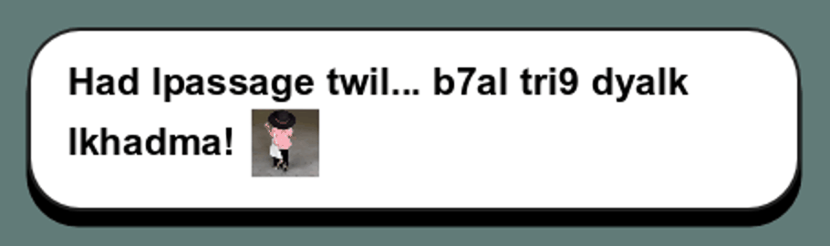
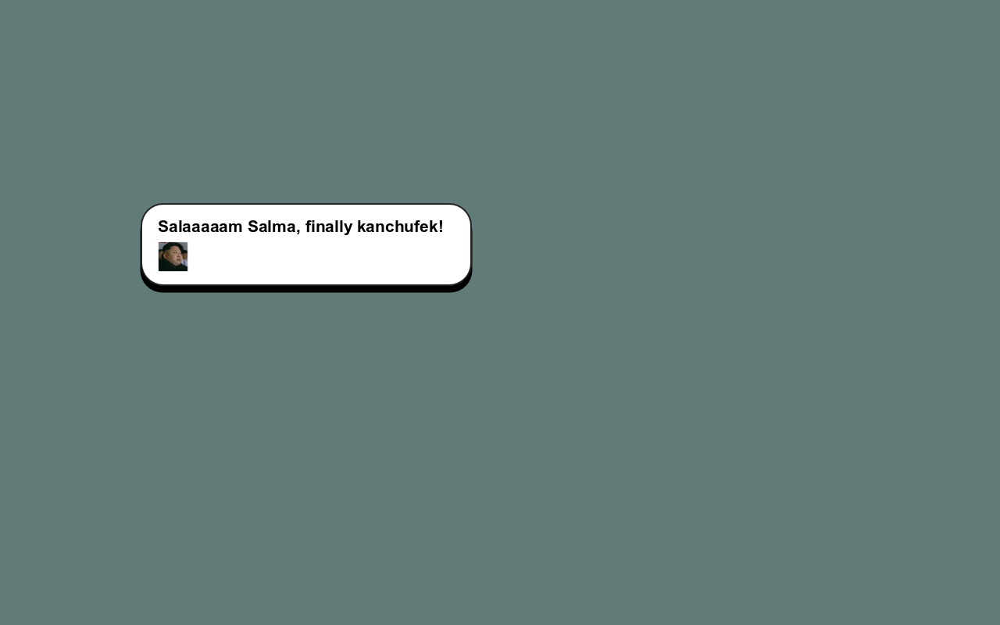

# Dialogue stickers

Applied the supplied dialogue wording, removed the requested garden comment, and assigned 19 stickers across 27 distinct lines. Both doors share the existing mouse sticker. The requested butterflies sticker uses the original file named `butterfliies.webp`.

The source collection contains ten animated assigned stickers and nine still assigned stickers. Still sources stay still. Original files remain unchanged under `assets/stickers/source/`, ignored by the Godot importer because animated WebP files are not decoded by its ordinary texture import. One source, `flouss.webp`, contains PNG data despite its extension.

Run `python art/stickers/build_stickers.py` from the repository root to regenerate the PNG frame sheets, SpriteFrames resources, and preload library. The build preserves frame timing, crops transparent margins using a shared animation bound, and uses 128-pixel cells for small dialogue stickers. Existing opaque backgrounds are preserved.

Stickers appear when the line finishes typing. Their height is 1.3 times the font height. They follow the final word when space permits, otherwise they wrap below it. The panel and shadow grow to contain them. New messages clear the previous reaction, and animation pauses with the game. Plain text retains its punctuation timing and voice ticks.

Validated all assignments, layout containment, animated frame advancement, pause behavior and message reset in `tests/dialogue_stickers.gd`. Inspected native screenshots at different animation frames. Full first-stage/gap flow, reunion/cake/birthday/restart flow, passage dialogue, progressive bubble layout, text pacing, and the game self-test pass.

The full revised script and sticker assignments are in [dialogue.md](../../dialogue.md).
