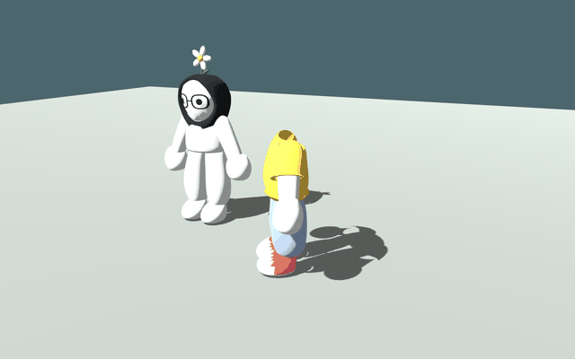
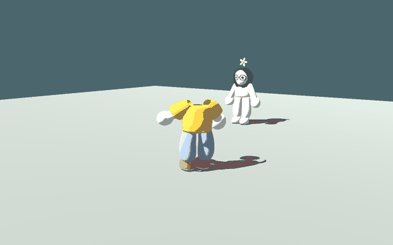

# Birthday companion motion

This records the earlier headless celebration pass. The [reunited garden update](../reunited-garden/README.md) now restores the head before dancing and adds autonomous roaming and comments.

The third glass hit starts a six-second celebration. The body faces Salma and sways with alternating arm and elbow movement and small knee bends. The pose fades in and out. If Salma leaves during the dance, it finishes early after a short celebration so he can follow her.

Afterward, he follows the existing visible side/front offset. He walks, sometimes chooses a running spell, runs when he falls behind, and occasionally hops while moving. Acceleration and distance-based slowing bring him to rest beside a stationary player. Hop timing and movement style are chosen at intervals, rather than randomly every frame. Pause freezes both the dance and the movement timers.

Editable settings in `GardenCharacter`, under Birthday companion:

| Setting | Default |
| --- | --- |
| Walk / run speed | 3.4 / 6.6 |
| Catch-up distance | 6 units |
| Stopping distance from follow position | 0.65 units |
| Hop interval | 4–8 seconds |
| Hop strength | 3.4 |
| Movement-style interval | 3–6 seconds |
| Chance of choosing a run | 30% |
| Dance duration | 6 seconds |

The native previews use the real imported body and clothing with the head still detached, matching this chapter. The follow preview uses the default intervals with a four-second first hop. Frame sequences were inspected, and the automated test checks dance articulation, pausing, walk/run/hop variation, catching up and stopping. The reunion test verifies that the third glass hit enables this mode. Restart recreates the companion with garden mode off.
