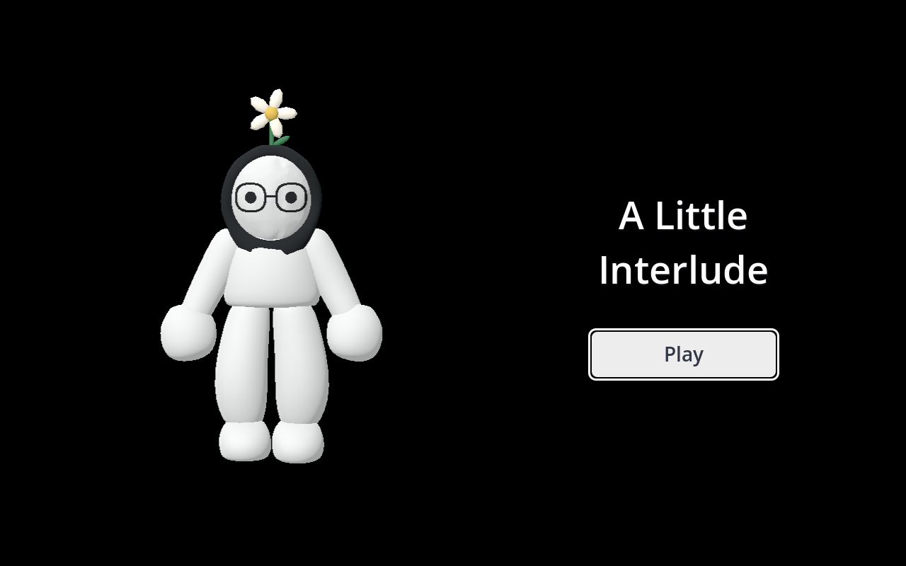
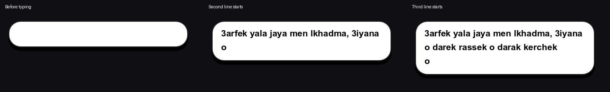
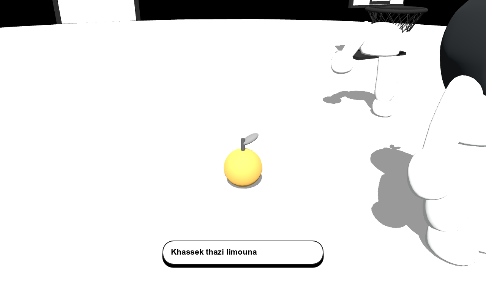
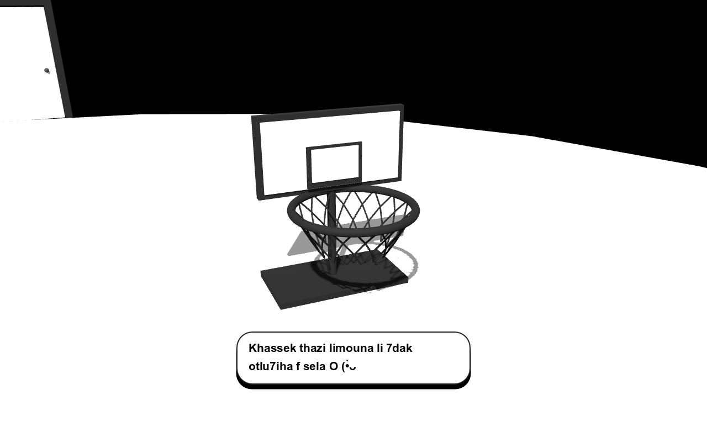
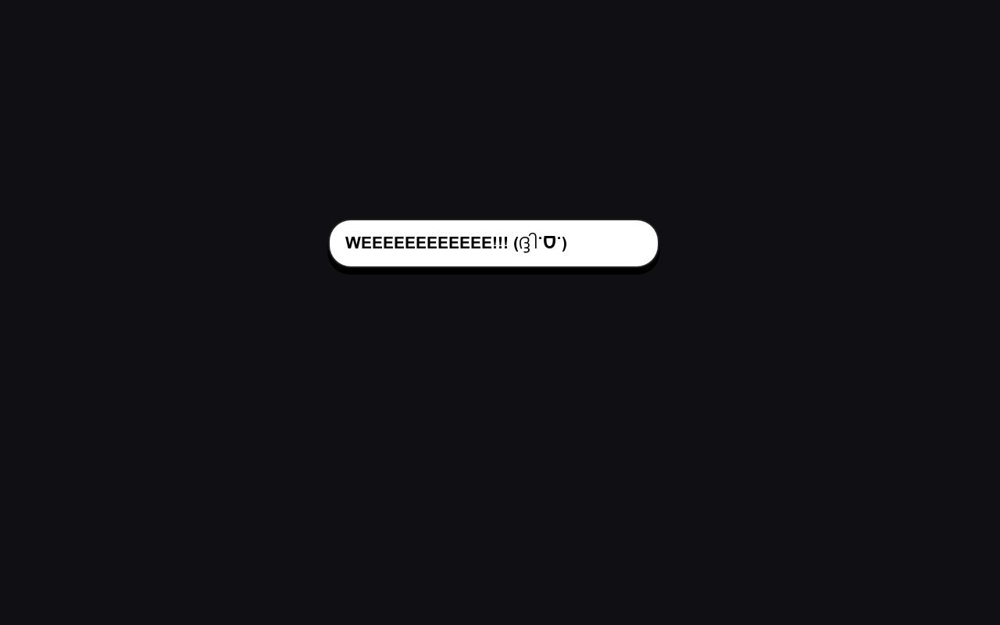

# A Little Interlude presentation

The application, window and entrance now use A Little Interlude. The floating entrance character rotates continuously at 0.45 radians per second, one turn in about 14 seconds.

Speech starts one line tall and expands when the next wrapped line is revealed. Wrapping uses the full sentence so words do not jump between lines; the background, border and shadow use only the revealed character bounds. Reveal-all and offscreen speech still work.

Normal play uses the same 12-unit follow distance in maps and passages. The extra gap-stage camera displacement is removed. Tutorial cues remain temporary exceptions. The fruit instruction first shows the lemon, moves to the basket, then returns to the saved player view.

Quiet passages get occasional jokes after a seven-second gap. They do not interrupt existing dialogue, and four lines are available across the two passages.

The detached head now greets Salma before explaining the glass puzzle:

- Salaaaaam Salma, finally kanchufek! (˶ᵔᵕᵔ˶)
- Happy birthdaaaaay! :D
- Khasski tharssi zaj bach takhdi lcadeau dyalk... (˶ᵔᵕᵔ˶)
- Ach ban lik thazi rass dyali otharssi bih zaj... (¬_¬)

Reaction faces come from the requested [EmojiDB reaction collection](https://emojidb.org/reaction-emojis). Existing emoticons remain; suitable faces were added to plain lines, including the requested WEEEE reaction. Explicit system-font fallbacks support the reaction scripts on this Windows installation.

Validated progressive panel height in native renders, continuous rotation past a full turn, name, shared follow distance, passage chatter, lemon-before-basket camera order and return, title controls, full journey, head greeting order, birthday/restart, misses, dialogue movement/pause and the physics self-test.
