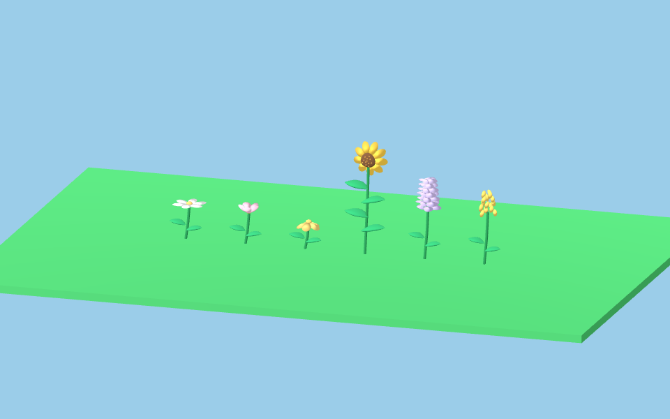
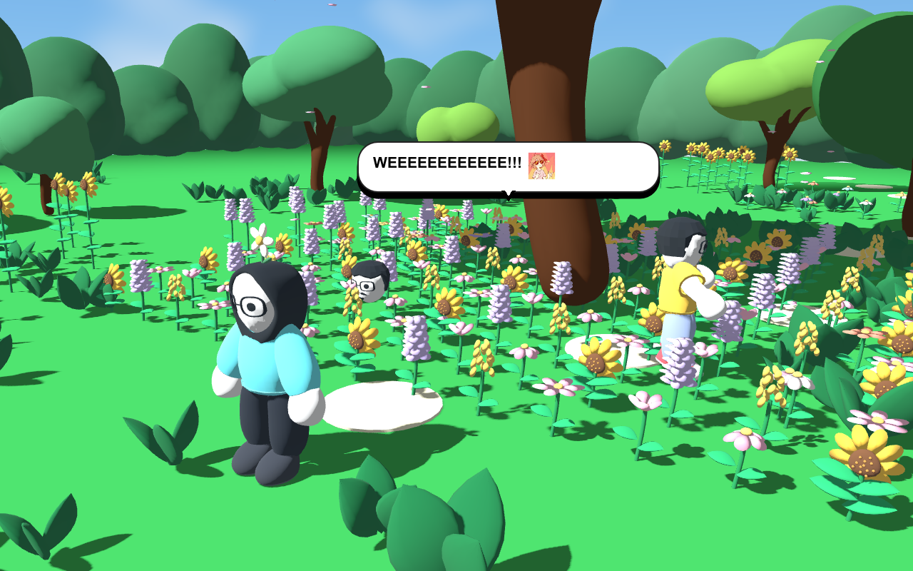

# Music and performance audit

The supplied song now loops at -26 dB with a 2.5-second fade-in. The file was already MP3 audio under an `.mpeg` extension; the extension is corrected without another lossy encode. Native playback tests cross the actual song-end boundary and verify looping, fade volume, mute, independent effects, and shutdown.

## Measurements

Native Godot 4.7.2 Compatibility renderer, AMD Ryzen 7 6800U with integrated Radeon graphics, 15.2 GiB usable system RAM. Window 1280 × 800, VSync disabled, uncapped rendering, normal physics timing. Each scene samples 180 frames after 40 settling frames; title samples 120. Garden scenes deliberately include 160 planted flowers and a synthetic worst-case trail of 180 flowers.

Frame times are wall-clock intervals between process frames, so they include rendering, scheduling and occasional stalls. These are developer-build measurements on this PC, not a guarantee for every computer. Lower is better. Draw counts include rendering passes. Raw captures are in [before.json](before.json) and [after.json](after.json).

| Scene | Median frame ms before → after | 95th percentile ms before → after | Draw calls before → after |
| --- | --- | --- | --- |
| Title | 3.72 → 0.81 | 5.77 → 1.49 | 458 → 34 |
| First stage | 3.96 → 3.71 | 9.11 → 6.14 | 429 → 429 |
| Passage | 1.58 → 1.64 | 2.56 → 3.28 | 64 → 65 |
| Gap | 1.59 → 1.56 | 3.47 → 3.14 | 75 → 76 |
| Glass | 3.07 → 2.90 | 6.01 → 4.36 | 212 → 200 |
| Garden growing | 7.57 → 8.55 | 14.30 → 18.48 | 298 → 284 |
| Mature garden | 9.17 → 9.51 | 17.82 → 18.10 | 3,396 → 1,116 |
| Garden with full trail | 13.68 → 12.49 | 25.76 → 22.62 | 10,231 → 2,912 |

The stable reductions are 93% fewer title draw calls and 72% fewer full-trail draw calls. Frame-time improvements vary between runs. No broad FPS increase is claimed for the mature garden or growth phase.

The glass-break setup call fell from 207.8 ms to 64.7 ms. Another final run measured 55.8 ms. Individual outfit setup dropped from 59.6/27.1 ms for the two characters to 13.9/8.9 ms. Ten thousand unchanged dialogue-layout requests dropped from 89.1 ms to 8.7 ms in a separate headless CPU probe.

## Changes

- The title keeps its floating character viewport but hides the covered world and actors until Play. The hidden title viewport already stops drawing during gameplay.
- Fully grown flowers group identical petals and leaves into MultiMeshes. Growth pivots and transforms stay intact, and pose edits can restore the original pieces.
- Soil clipping uses a shared material uniform per color and ground height. This removes the per-instance shader allocation limit that the baseline full-trail case exceeded.
- Delayed flowers construct their meshes when emergence starts. Their growth delays, root positions and unfolding animation remain unchanged.
- Clothing skips rebuilding the separate HEAD and HAND meshes. Inspection confirmed these bind only to their identity bones. Other imported layouts retain the existing filtering path.
- Dialogue layout recalculates when text, reveal count, width, font or font size changes, instead of repeating unchanged work every frame.

## Visual and functional checks

Compared the six flower species from the same camera throughout emergence. The final before/after image mean absolute channel difference is 0.15 out of 255, with no intended design change. Inspected the native mature-garden stress view and title. The stress setup is an instrumented scene, not a story screenshot.

Passing checks: native `background_music.gd`, `title_menu.gd`, `dialogue_stickers.gd`, `flower_growth_preview.gd`; headless `flower_batch.gd`, `lemon_outfit.gd`, `interlude_ui.gd`, `journey_flow.gd`, `reunion_cake.gd`, `garden_soul.gd`, and the game self-test. The final native stress run has no shader-instance-limit errors.

Reproduce the scene profile with `Godot --path . --script tests/performance_profile.gd -- --profile-tag=review`. It requires a native renderer and saves JSON plus screenshots under `artifacts/performance/`. Use `--fixed-fps 60` for functional tests, not this wall-clock benchmark.

## Remaining costs

Growth still produces occasional long frames. The final run recorded a 155 ms growth spike; a previous final run recorded 90 ms. The 95th percentile in dense garden scenes remains above the 16.7 ms budget for a consistent 60 FPS. Future work should investigate GPU shader/driver stalls and flower-level visibility or distance detail before reducing the garden's design.

The 180-flower trail cap remains. Peak monitored static allocations rose from 114.6 to 124.2 MiB, including roughly 8 MiB for the newly loaded compressed song and additional batching data. Monitored video allocation stayed around 123 MiB. These Godot counters exclude parts of driver and operating-system memory. Startup varied from 434 ms before to 457 ms in the final run, so no startup improvement is claimed.
