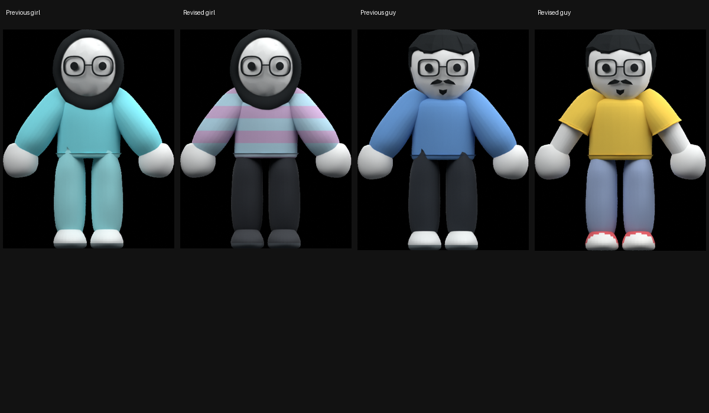

# Outfits, flowers and dialogue pacing

Fresh HD study captures from Bryson's video at approximately 707.11, 732.75 and 737.75 seconds are saved locally in the adjacent workspace's `game reference/outfits-flowers-study`. They guide the pastel striped sweater, dark loose trousers, yellow short sleeves, lavender trousers, red/white shoes and mixed flower trail. The established faces and headwear remain unchanged. Reference screenshots are not shipped as assets.

The clothes remain independent skinned meshes. The sweater bands use an authored repeating texture on the garment UVs. Short sleeves include separate exposed forearm surfaces so upper arms do not poke through the shoulder. Trouser tops tuck inside the hem.

The walking trail now includes the same six constructions used in the garden, including six-petal daisies, rounded sunflowers, lavender tiers and narrow yellow spikes. Stems rise, leaves unfold and petals open at their own pivots. A soil clipping plane conceals the buried geometry during emergence. Root transforms and whole-plant scale stay fixed.

Dialogue uses a 44 ms base interval instead of 34 ms, slows across the two-character approach to punctuation and pauses longer afterward. Ellipsis clusters have shorter internal pauses. Queued message duration includes the actual reveal time and a reading interval. The reveal-all label state is preserved.

Validation passed: dialogue pacing/pause/replacement checks, independent garment modules and weights, native Godot front/back/side and walking/jumping/throwing previews, the six-species emergence capture, gameplay self-test and the full reunion/cake/birthday/restart test. Native clothing review uses the game's actual ambient-light energy. Inspected the render sequence for fit, fixed roots and growth without whole-plant scaling.
