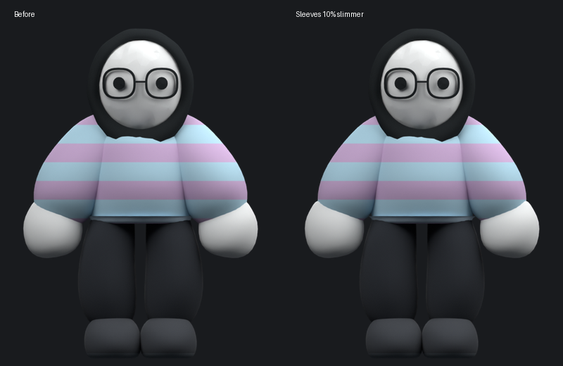
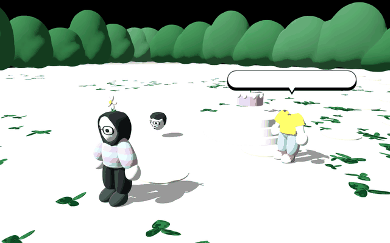

# Reunited garden companion

The leg-reveal line is now `Hahiya rajli fjiha lakhra`. It gets the same eased camera cue as the basket instruction: show the leg, keep the speech readable, then return before the companion attempts his jump. Repeated reminders do not replay the cue.

Salma's sweater sleeves are 10% narrower, with smaller matching cuffs. The body, face and rig are unchanged.

After the third glass hit, the garden begins growing. The body waits for the thrown head to land, approaches it, bends to collect it and lifts it onto the existing head attachment. The loose head disappears only after the original head meshes are restored. Dialogue then anchors to the reunited character. Restoring a body part keeps covered body modules hidden beneath the outfit.

The reunited companion dances, then chooses changing destinations near Salma. Destinations favor the central camera area, stay within the garden banks and leave personal space around the player. He walks, runs and hops using the existing adjustable timings. Distant goals trigger catch-up rather than leaving him behind. Both characters leave flowers that grow from the ground; stationary or airborne characters do not plant trails.

Ambient comments wait until the birthday dialogue finishes. They are spaced 16–26 seconds apart, only play nearby and in view, and do not repeat consecutively. He briefly pauses and faces Salma or the flower. Leaving him behind ends the pause so he can catch up.

- `Had lwarda zwina b7al Salma! :P` requires a mature flower nearby and a stopped character.
- `Chufi! Fin kandouz kaytla3 lward :3`
- `Wa had jerda katzid tzian bik!`
- `Salma, had nhar dyalk. Khodi ra7tek :)`
- `Kan9elleb 3la chi blassa zwina ntsawro fiha :P`

Adjust `garden_roam_radius`, `garden_goal_interval` and `garden_comment_interval` alongside the earlier walk/run/hop settings.

Validation covers the leg camera cue and return, complete story and restart, head approach/pickup/attachment, speech transfer, clothing coverage after restoration, companion trail growth, contextual flower comments and repeat prevention. In a 600-frame moving-player scenario the companion must remain inside the inset camera region for more than 70% of frames. Native reunion frames, slimmer-sleeve Blender views and imported walk/jump/throw clothing poses were inspected.
