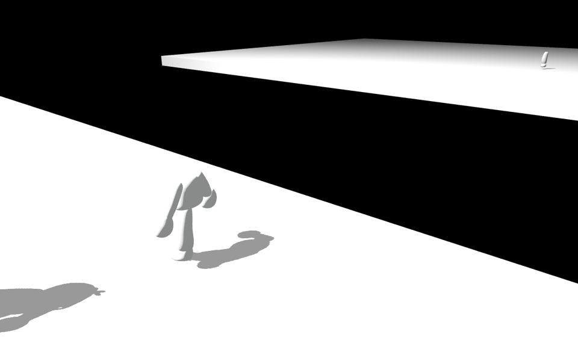
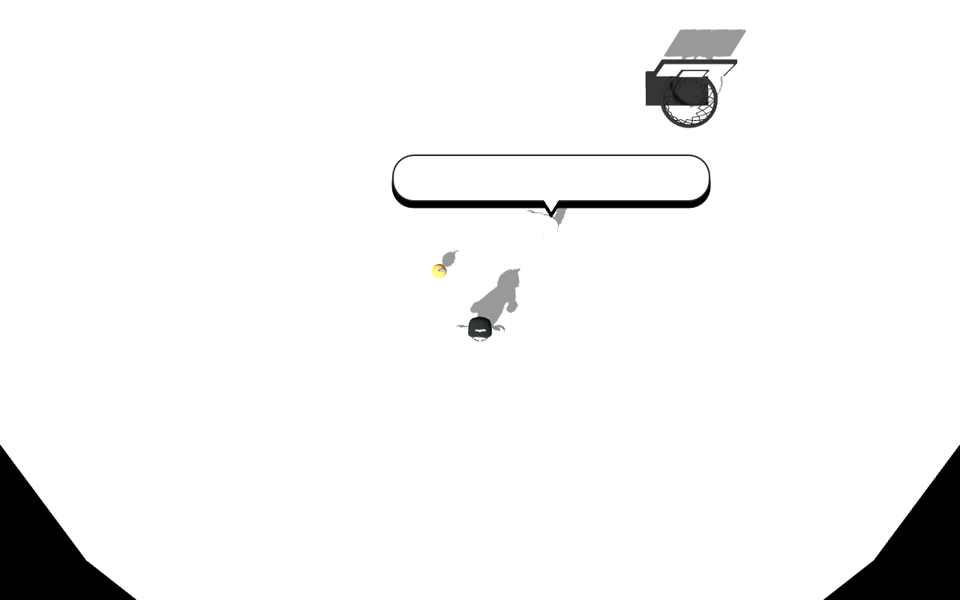
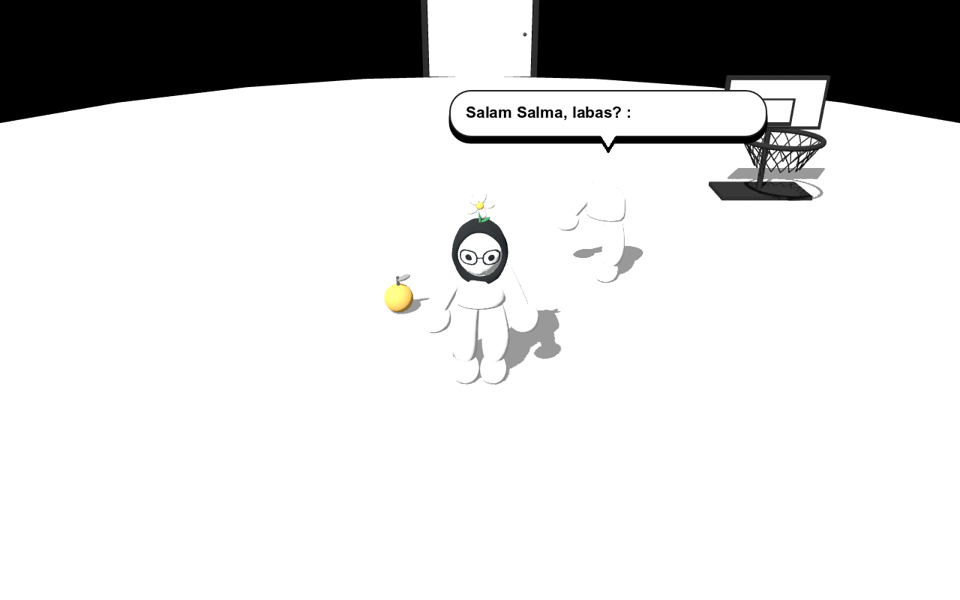
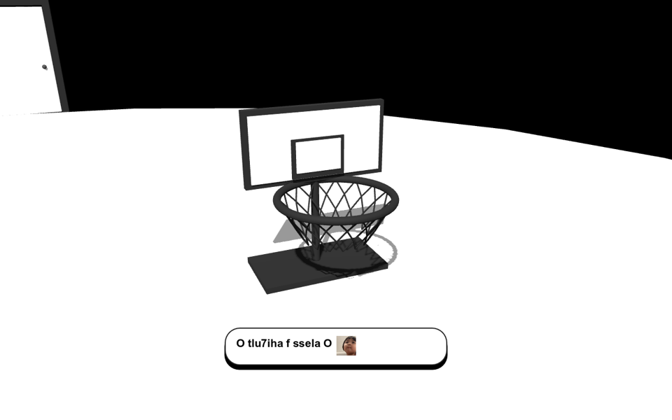
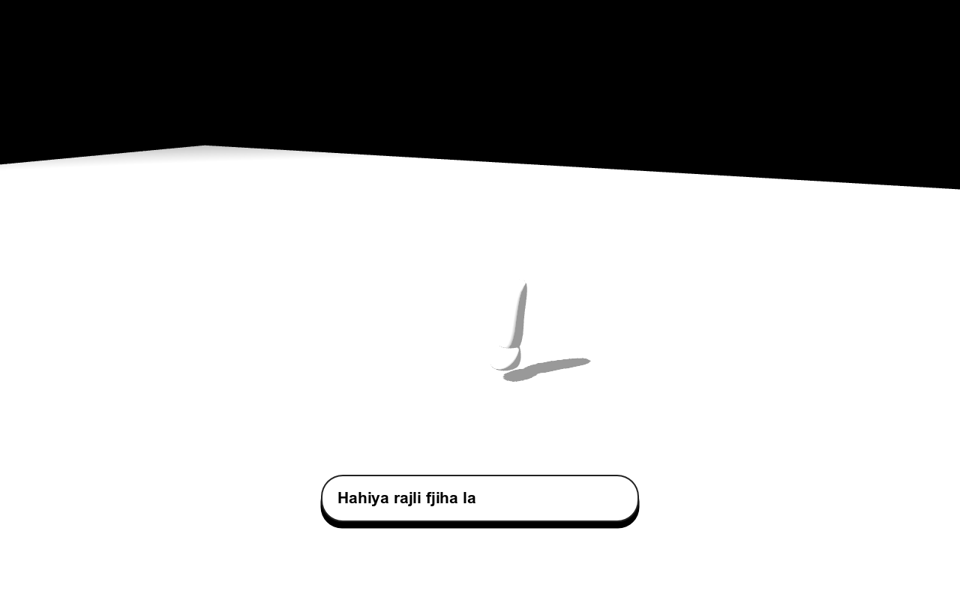

# Stage camera and one-leg leap

Starting the game blends from overhead into the normal player camera over 2.4 seconds. Movement and interaction wait for that entrance to finish. Restart uses the same sequence.

The first tutorial has two lines, each with its own shot and three-second reading pause. The lemon shot says "Khassek thazi limouna li 7dak". The basket shot says "O tlu7iha f ssela O" with the existing ok sticker. The camera moves directly between the subjects, then returns to the player.

The leg introduction starts just after the player passes the arrival doorway. Its camera cue lights the distant platform for visibility. The player no longer has to walk near the gap to trigger it.

The companion approaches the edge with his existing one-leg hopping controller. A planted 0.24-second crouch precedes the failed leap, which uses the same one-leg airborne knee and arm pose. The scripted sequence no longer advances a walking gait. He falls without respawning, and the far platform still fades away smoothly.

Native `tests/stage_camera.gd` verifies the entrance endpoints, separate tutorial shots, sticker assignment, doorway trigger, and crouch/leap/fall. Its fixed review camera captures the jump without changing the gameplay camera. Inspected rendered frames across the motion. `tests/basket_experience.gd`, `tests/journey_flow.gd`, `tests/reunion_cake.gd` and the game self-test pass. The self-test now waits for the entrance, so its documented frame budget is 750.
