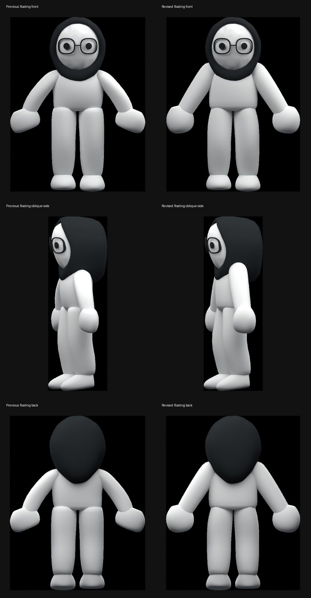

# Static character review

The comparisons use matching orthographic front, side and back camera angles. Each character is cropped to its visible silhouette and displayed at the same height. Left is the committed baseline; right is this static refinement. These images are our own Blender renders. Third-party study screenshots remain outside the published assets.

- [Body comparison](body-before-after.png)
- [Clothed comparison](outfit-before-after.png)

The pass reshapes the existing control cages: a slightly uneven compact torso, fuller upper-arm silhouette, irregular mitten palms, nonuniform leg profiles and shoes with a distinct heel, toe box and sole. The ten body modules stay independent. Identity meshes, bone rest matrices and body vertex/face counts are unchanged against the baseline. The established head proportion is retained.

Validation uses `art/character/validate_static_revision.py`, `validate_modules.py`, Godot's imported-character checks and the static-only capture path in `tests/soft_visuals.gd`. Walking, jumping and throwing code is unchanged. A coordinated walk cycle remains a separate task after this static review.
# Reference refinement follow-up

The supplied floating front, side and back views guide this static pass. Their flower is excluded when normalizing displayed body height. Floating foot angles are pose evidence, not a reason to deform the neutral feet.

The follow-up reshapes the oval hands into angled palms with compressed undersides, reduces torso depth, softens the lower-leg width changes and extends the shoe toe. Face, hood, glasses, rest bones, topology and animation code remain unchanged. The companion uses the same body edits.

Inspected Blender front, side and back views and native Godot static views. Identity/rest-rig/topology invariants, independent-module checks, imported-character checks and the gameplay self-test pass.

This is a closer static iteration, not a pixel-perfect reproduction or a 10/10 council result. The retained hood silhouette and head/body balance still differ from the source character. The original video page was unavailable during this pass; no new video captures were made. The full three-column comparison with the supplied reference is local at `artifacts/reference-refinement/reference-three-views.png`.

Council review was requested but could not run. The skill requires three model providers and this session exposes only OpenAI models. No substitute scores were assigned.

## Rounded hands and floating-pose correction

The next review corrected the earlier interpretation of the supplied images. The palm now has nearly equal front-view width and height with rounded depth. Arm rings run perpendicular to the limb centerline with circular cross-sections. Custom torso rings give the hem a broader overlap; thigh roots extend inside it instead of sitting beneath it as exposed caps.

`render_reference_pose.py` captures neutral and relaxed suspended poses separately. The side study uses an estimated 75 degree camera, since the supplied view is not a calibrated 90 degree side view. These are static review poses only; they are not saved into the production rig or animation controller. Identity geometry, rest bones, topology and the ten independent modules remain unchanged.

The source video was accessible for this correction. Local HD screenshots at 25, 30, 35, 40, 497.93, 597.52, 617.52, 617.62, 617.92 and approximately 714.97 seconds cover suspended rear posture, rear gameplay, carrying, successive side strides and the birthday scene. The supplied front and near-side images remain the clearest shape targets. Screenshots and their contact sheet are in the adjacent workspace's `game reference/video-study`, outside shipping assets. Buffered exploratory seek captures were discarded.

Inspected the Blender neutral/floating views, the equal-height reference comparison and native Godot static output. Exact identity/rest-rig/topology checks, module validation, imported-character checks and the gameplay self-test pass. The source head silhouette still differs because the established hood and glasses are preserved; no pixel-perfect or council score is claimed.
