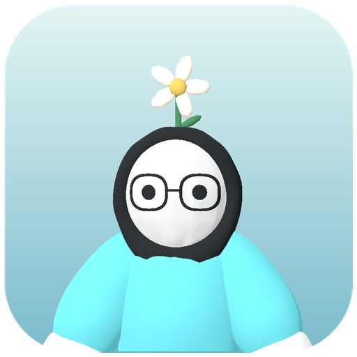
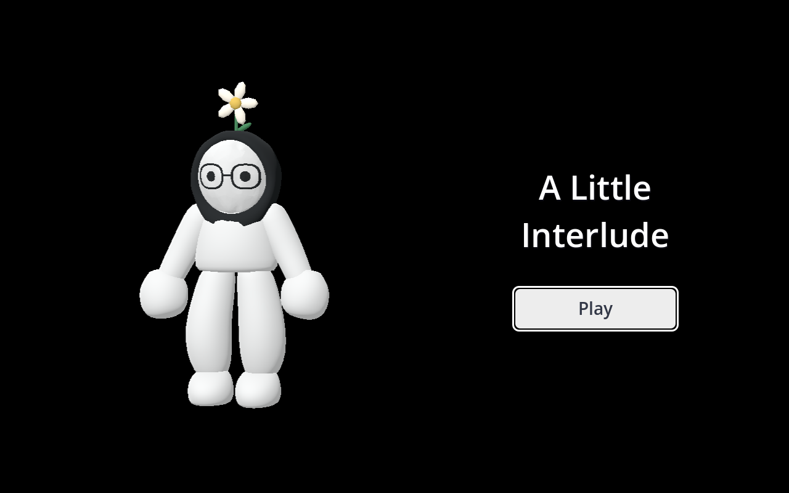

# Windows release and garden music

Built `dist/A Little Interlude.exe` as a Windows x86_64 release with embedded PCK data. The executable is 129,585,200 bytes, approximately 123.6 MiB. It needs no separate game-data file or Godot installation. Development tools, tests, study references and review documents are excluded from the pack.

Music starts at the user's -42 dB setting. The third glass hit fades it to -32 dB over 2.5 seconds without restarting the recording. Earlier hits leave it at -42 dB. Native audio tests verify the intermediate volume, final target, actual loop boundary, mute and independent effects.

The icon renders the existing player model with her glasses, hijab, flower and cyan sweater, against a rounded pastel background. The PNG is used for the application icon. The ICO contains 16, 24, 32, 48, 64, 128 and 256 pixel sizes for Windows. The exported EXE's associated icon was extracted and inspected, and its product name and version were checked.

The exported executable launched successfully both with a native renderer and in headless mode. Its embedded pack footer is present, native movie capture rendered the title screen, and the exported self-test completed with exit code 0 and no errors. Source-build self-test and full reunion/cake/birthday/restart tests also pass with assertions enabled.

SHA-256 of this build: `4378D666F803184275A92291568DB0E6AE286B1805AA61AE3C5658DC01C79B57`.

Rebuild using `tools/export_windows.ps1`. Regenerate the icon with `Godot --path . --script tools/render_icon.gd`, then `python tools/build_icon.py`, then export again. The icon composition script requires Pillow. This build uses Godot 4.7.2's built-in Windows resource editor, so no separate icon-editing executable is needed.
